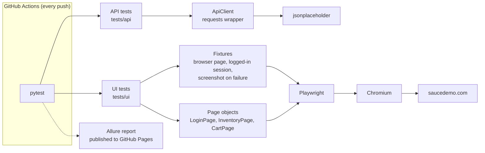

# Playwright + pytest Test Framework

[](https://github.com/kayla-damoah/playwright-pytest-framework/actions/workflows/ci.yml)

API and browser test automation in Python with pytest and Playwright, run in GitHub Actions on every push.

**[Live test report](https://kayla-damoah.github.io/playwright-pytest-framework/)** (Allure, rebuilt on every push to `main`)

Targets: [JSONPlaceholder](https://jsonplaceholder.typicode.com) for the REST API and [Sauce Demo](https://www.saucedemo.com), a public practice shop, for the UI.

For the design in more detail, see [docs/HOW_IT_WORKS.md](docs/HOW_IT_WORKS.md).

## How it fits together



## What it demonstrates

- **REST API testing**: status codes, response schema checks, filtering, create/update/delete, and 404 handling, with parametrized cases.
- **Page Object Model**: selectors and page behavior live in `framework/pages/`; tests only describe intent.
- **Playwright auto-waiting and `expect`**: assertions retry until the page catches up, so there are no fixed sleeps.
- **Fixtures**: `conftest.py` files provide a logged-in session, a consistent viewport, and a screenshot attached on failure.
- **Markers**: `api`, `ui` and `smoke` select subsets of the suite.
- **Allure report**: steps, grouping by feature, and failure screenshots, published to GitHub Pages on every run.
- **Playwright traces**: failed UI tests keep a trace you can open with `playwright show-trace`.

## Run it

Needs Python 3.9+.

```bash
python3 -m venv .venv && source .venv/bin/activate
pip install -r requirements.txt
playwright install chromium

pytest                    # everything
pytest -m api             # REST API tests only
pytest -m ui              # browser tests (add --headed to watch)
pytest -m smoke           # fast subset
```

Point the API tests at another server with `API_BASE_URL=https://... pytest -m api`.

Results land in `reports/allure-results/`. To view them locally, install the Allure command line and run `allure serve reports/allure-results`. The latest CI run's report is linked at the top.

## Layout

```
framework/
  api_client.py        requests wrapper used by API tests
  pages/               LoginPage, InventoryPage, CartPage
tests/
  api/                 REST API tests
  ui/                  browser tests and their fixtures (conftest.py)
conftest.py            shared fixtures (API client)
pytest.ini             markers and default options
.github/workflows/     CI: run tests, build the report, publish it
```

## Ideas to extend

- Run the UI tests on Firefox and WebKit as well
- Parallel runs with `pytest-xdist`
- Contract tests with JSON Schema
- Report history across runs
